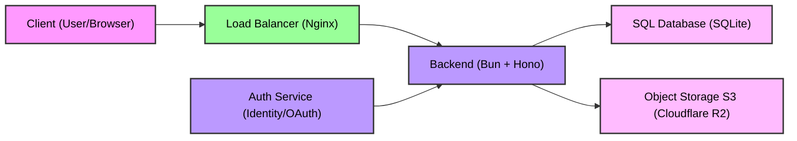

# FileVault API
A backend test project for **`Nginx`**, **`Hono`** and **`Object Storage S3`** with **`Cloudflare R2`**

## DB Structure

<table align="center">
    <tr>
        <td colspan="15" align="center" ><b>Users</b></td>
    </tr>
    <tr>
        <td>Id</td>
        <td>Name</td>
        <td>Username</td>
        <td>Email</td>
        <td>Password</td>
        <td>Created_At</td>
        <td>Is_Active</td>
    </tr>
    <tr align="center">
        <td>UUID</td>
        <td>String</td>
        <td>String</td>
        <td>String</td>
        <td>SHA256</td>
        <td>DateTime</td>
        <td>Boolean</td>
    </tr>
</table>

<table align="center">
    <tr>
        <td colspan="15" align="center"><b>Follows</b></td>
    </tr>
    <tr>
        <td>Follower_Id</td>
        <td>Following_Id</td>
        <td>Followed_At</td>
    </tr>
    <tr align="center">
        <td>Users.Id</td>
        <td>Users.Id</td>
        <td>DateTime</td>
    </tr>
</table>

<table align="center">
    <tr>
        <td colspan="15" align="center"><b>S3</b></td>
    </tr>
    <tr>
        <td>Id</td>
        <td>Created_By</td>
        <td>Link</td>
        <td>Created_At</td>
    </tr>
    <tr align="center">
        <td>UUID</td>
        <td>Usera.Id</td>
        <td>String</td>
        <td>DateTime</td>
    </tr>
</table>

<table align="center">
    <tr>
        <td colspan="15" align="center"><b>Posts</b></td>
    </tr>
    <tr>
        <td>Id</td>
        <td>Created_By</td>
        <td>Attachment_Id</td>
        <td>Created_At</td>
        <td>Is_Deleted</td>
    </tr>
    <tr align="center">
        <td>UUID</td>
        <td>Users.Id</td>
        <td>S3.Id</td>
        <td>DateTime</td>
        <td>Boolean</td>
    </tr>
</table>

<table align="center">
    <tr>
        <td colspan="15" align="center"><b>Likes</b></td>
    </tr>
    <tr>
        <td>Id</td>
        <td>User_Id</td>
        <td>Liked_At</td>
    </tr>
    <tr align="center">
        <td>Post.Id</td>
        <td>Users.Id</td>
        <td>DateTime</td>
    </tr>
</table>

## Config
```bash
To install dependencies:
    bun install

To run:
    bun run index.ts
```

## System Design


###### This project was created using `bun init` in bun v1.3.3. [Bun](https://bun.com) is a fast all-in-one JavaScript runtime.
